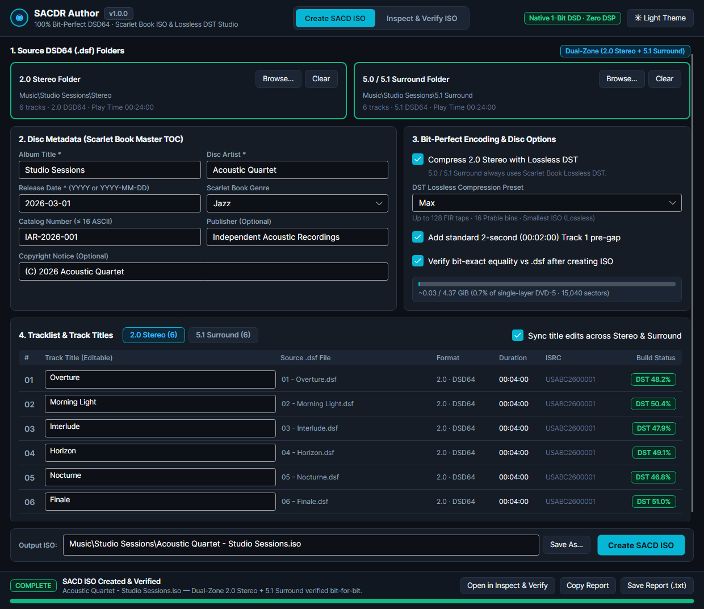

# SACDR Author

[](https://github.com/guipel/sacdr-author-releases/releases)
[](LICENSE)

**Bring your digital DSD collection to your living-room universal SACD-R player.**

**SACDR Author** creates bit-perfect **SACD-R `.iso` disc images** from your `.dsf` albums—ready to burn onto standard DVD media and play on compatible universal SACD-R players, as well as music servers and desktop DSD players.

Available as a self-contained desktop app and command-line tool for **Windows, macOS, and Linux**.



## Highlights

- **Effortless From Folder to Disc** — Drag in your `.dsf` album folder, review the auto-filled album and track titles, and click **Create SACD ISO**. No cue sheets, authoring scripts, or legacy studio tools needed.
- **100% Bit-Perfect Native DSD** — Zero PCM conversion, resampling, or signal processing. Built-in verification checks the finished `.iso` to confirm every audio sample matches your source `.dsf` files bit-for-bit.
- **Bit-Perfect Lossless Compression** — Built-in multi-core lossless audio compression packs full-length `5.1 Surround` and **Dual-Zone** albums onto a standard `4.7 GB` single-layer DVD without losing a single bit of audio quality.
- **Stereo, 5.1 Surround & Dual-Zone Discs** — Author dedicated `2.0 Stereo` discs, `5.0 / 5.1 Surround` discs, or commercial-style **Dual-Zone** discs carrying both Stereo and Surround mixes on one disc.
- **Built for Universal SACD-R Players** — Produces `SACD-R` disc images engineered for reliable recognition across compatible universal disc transports *(note: physical `SACD-R` playback on DVD media requires a compatible universal player; standard SACD-only players cannot read DVD media)*.
- **Desktop App + Batch CLI Anywhere** — Runs out of the box on **Windows**, **macOS** (`ARM64` & `x64`), and **Linux** with nothing extra to install—use the visual studio for single albums or `sacdr-author-cli` to automate a library.

---

## Download & Installation

Download the latest package for your computer from **[Releases](https://github.com/guipel/sacdr-author-releases/releases)**:

| Platform | Download | Contents |
| :--- | :--- | :--- |
| **Windows 10 / 11** (`x64`) | `sacdr-author-vX.Y.Z-win-x64.zip` | `sacdr-author-gui.exe` + `sacdr-author-cli.exe` |
| **macOS 12+** (`M1`–`M5` `ARM64`) | `sacdr-author-vX.Y.Z-macos-arm64.zip` | `SACDR Author.app` + `sacdr-author-cli` |
| **macOS 12+** (`x64`) | `sacdr-author-vX.Y.Z-macos-x64.zip` | `SACDR Author.app` + `sacdr-author-cli` |
| **Linux** (`x64`) | `sacdr-author-vX.Y.Z-linux-x64.tar.gz` | `sacdr-author-gui` + `sacdr-author-cli` |
| **Linux** (`ARM64`) | `sacdr-author-vX.Y.Z-linux-arm64.tar.gz` | `sacdr-author-gui` + `sacdr-author-cli` |

### Windows
1. Extract **`sacdr-author-vX.Y.Z-win-x64.zip`** to any folder.
2. Double-click **`sacdr-author-gui.exe`** to open the desktop app. *(If SmartScreen prompts on first launch, click **More info** → **Run anyway**.)*
3. For the command line, run `.\sacdr-author-cli.exe -Help` in PowerShell or Command Prompt.

### macOS
1. Double-click the downloaded `.zip` in **Finder** and drag **`SACDR Author.app`** to **Applications**.
2. **First launch only:** Because the app is distributed free without a paid developer signing certificate, approve it once:
   - **macOS 15 or newer:** Open **`SACDR Author.app`** → click **Done** on the prompt → go to **System Settings → Privacy & Security** and click **Open Anyway**.
   - **macOS 12–14:** Right-click **`SACDR Author.app`** → **Open** → **Open**.
   - **Or via Terminal:** `xattr -cr "/Applications/SACDR Author.app"`
3. For the command line, run:
   ```bash
   xattr -cr ./sacdr-author-cli
   ./sacdr-author-cli -Help
   ```

### Linux
1. Extract the archive and launch the desktop app or CLI:
   ```bash
   tar -xzf sacdr-author-v*-linux-x64.tar.gz
   cd sacdr-author-v*-linux-x64
   ./sacdr-author-gui
   ```
   *(On minimal installations without X11/font packages, install `libx11-6 libice6 libsm6 libfontconfig1` on Debian/Ubuntu or `libX11 libICE libSM fontconfig` on Fedora.)*

---

## Quick Start

### Desktop App
1. **Drop your `.dsf` folder(s)** — Add a **2.0 Stereo** folder, a **5.0 / 5.1 Surround** folder, or **both** to build a Dual-Zone disc.
2. **Review metadata & compression** — Album, artist, year, genre, and track titles populate automatically from your `.dsf` files. Enable lossless compression when you want a large album to fit on a single-layer `4.7 GB` DVD.
3. **Create your `.iso`** — Click **Create SACD ISO** (and optionally verify bit-for-bit integrity automatically).
4. **Burn & play** — Burn the `.iso` as a **disc image** onto a quality `DVD-R` or `DVD+R` (`4x`–`8x` speed) with any standard disc-burning utility and play it in your compatible universal `SACD-R` player.

### Command Line (`sacdr-author-cli`)

```bash
# Stereo SACD-R ISO
sacdr-author-cli -Mode Stereo -StereoDir "./Album/Stereo" -Output "./Album.iso"

# Dual-Zone (Stereo + 5.1 Surround) with maximum lossless compression
sacdr-author-cli -Mode Hybrid -StereoDir "./Album/Stereo" -MultiDir "./Album/5.1" \
    -Output "./Album.iso" -CompressStereo -Compression Max

# Verify an authored SACD ISO bit-for-bit
sacdr-author-cli -Mode Verify -Output "./Album.iso"
```

Run `sacdr-author-cli -Help` to view all command-line options.

---

## Issues & Feedback

Found a bug or want to report compatibility with your universal `SACD-R` player? Open an issue on **[GitHub Issues](https://github.com/guipel/sacdr-author-releases/issues)**.

## License

- Distributed free for personal and noncommercial use under the **[SACDR Author License](LICENSE)** · **[Third-Party Open-Source Notices](THIRD-PARTY-NOTICES.md)** · **[Release History](CHANGELOG.md)**
- This software is provided **"AS IS"**, without warranty of any kind, express or implied, and without liability for any damages; use at your own risk.
- *Independent project, not affiliated with or endorsed by any trademark holder. Format designations are trademarks of their respective owners.*
